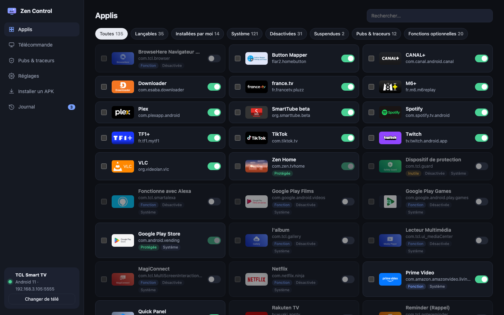
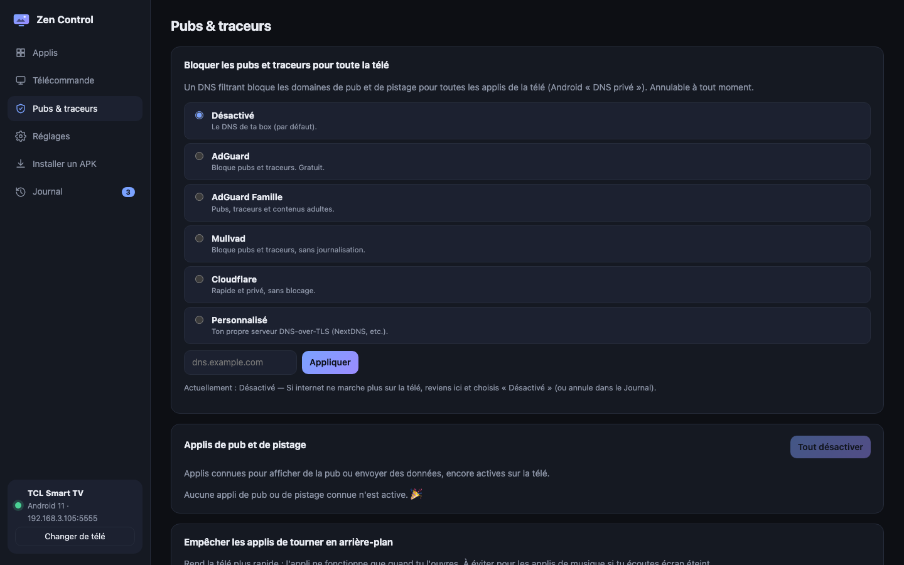

# Zen Control

**Manage your Android TV / Google TV from your browser** — every app (system ones included), ads & trackers,
a live remote, system settings, APK install. **Every change is journaled and can be undone.**

🇫🇷 [Lire en français](README.fr.md)



## What it does

| | |
|---|---|
| **Apps** | Every installed app with its real name and icon, filters (launchable, system, disabled, ads & trackers…). Enable / disable / suspend / force-stop / open / uninstall (your own apps only), background and auto-start rights, runtime permissions. Bulk actions. |
| **Ads & trackers** | One click to block ads and trackers for the **whole TV** with a filtering DNS (AdGuard, Mullvad…). Known ad/tracking apps detected and disabled in one click. Stop apps from running in the background. |
| **Remote** | Live view of the TV screen and a full remote (D-pad, OK, back, home, volume, media, power, text input). Works with your keyboard too. |
| **Settings** | Animation speed, sleep, screensaver, home screen, accessibility services, device info, restart, and an advanced editor for every Android setting. |
| **Install** | Drag an `.apk` into the page to install it on the TV. |
| **Journal** | Every change, with **Undo** per change or **Undo everything**. |

Nothing is uninstalled behind your back: system apps can only be disabled (reversible), and essential system
components are locked.



## Get started

1. **On the TV** (one time): *Settings → System → About* → click *Android TV OS build* 7 times →
   back to *System → Developer options* → turn on **USB debugging** (and **Network debugging** if present).
2. **Download** the zip for your computer from the [latest release](https://github.com/Hoax017/zen-control/releases/latest)
   and unzip it.
3. **Run it**:
   - **Windows**: double-click **`Zen Control.bat`** (if SmartScreen warns, *More info → Run anyway*).
   - **Mac**: double-click **`Zen Control.command`** (first time: right-click → *Open*).
   - **Linux**: `./zen-control`
4. Your browser opens **http://localhost:8765**. Pick your TV, then **accept the window on the TV**
   (*Allow USB debugging?* → tick *Always allow*).
5. Click **Install helper**: a tiny invisible app that lets Zen Control show app names and icons.

The first time, Zen Control offers to download **adb** (Google's official TV connection tool) from dl.google.com.

### From your phone

Run `zen-control --lan` (or `node server.js --lan`): it prints a link with a secret code to open on your phone
(same Wi-Fi).

## Safety

- The server only listens on your computer (`localhost`), refuses requests from other websites and from other
  host names. With `--lan`, a random secret code is required.
- Changes go through Android's own commands (`pm disable-user`, `appops`, `settings`…), never root.
- The journal and a snapshot of the TV's original state are stored in `data/` next to the program.
- The helper app's data can only be read through adb (it requires the `DUMP` permission that only adb and the
  system have).

## Developers

No dependencies. Node 18+:

```bash
node server.js            # http://localhost:8765
node server.js --lan      # reachable from your phone, with a secret link
./helper/build.sh         # dist/zen-tvhelper.apk (Android SDK + JDK 11+)
./tools/build-exe.sh      # single executables for Windows / Mac / Linux (needs bun)
```

Releases are built by GitHub Actions on a `v*` tag. The helper APK is signed with the secrets
`ZEN_KEYSTORE_B64`, `ZEN_KEYSTORE_PASS`, `ZEN_KEY_ALIAS`, `ZEN_KEY_PASS`.

The list of known ad / tracking apps is `known-apps.json` — pull requests welcome.

Sister project: [Zen TV](https://github.com/Hoax017/zen-tv) (guided cleanup script + Zen Home launcher).

## License

[MIT](LICENSE). Not affiliated with Google or any TV manufacturer.
